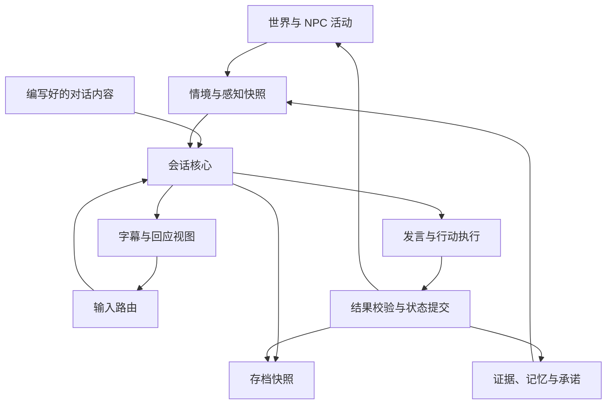
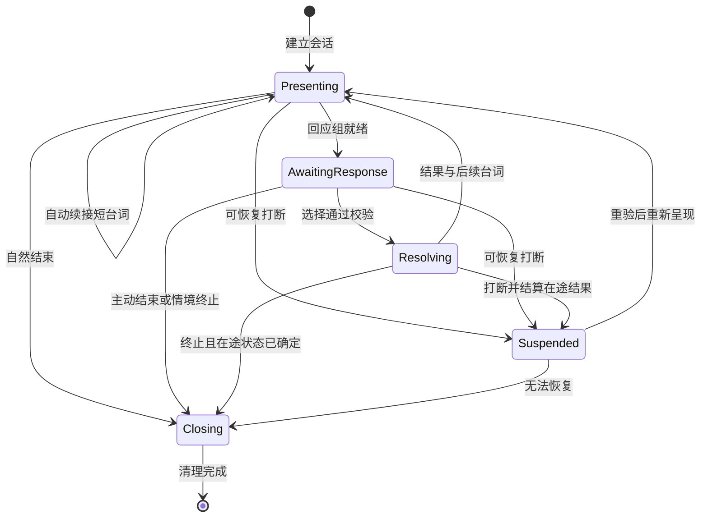

|文档信息|内容|
|---|---|
|项目|未定名游戏：生活型 NPC、隐性支线与关系记忆|
|文档范围|对话运行时，以及输入、感知、行动、关系和存档的接口|
|版本|v0.1 · 技术设计草案，尚未实现或性能验证|
|日期|2026-10-03（America/Los_Angeles）|
|配套文档|`Dialogue_System_GDD.md`，同版本|
|阅读对象|程序、技术策划、叙事工具开发与测试人员|

> 本文中的类型、接口和伪代码用于说明设计，不是可直接复制运行的引擎 API。JSON 是示例内容格式，不代表已建立完整解析器。技术选型保持引擎无关；若项目采用 Unity，可映射为 C# 数据与组件，但本文不要求特定引擎版本、插件或框架。

## 1. 实现目标与假设

### 1.1 基线假设

- 首版是本地单人游戏，一名玩家同一时刻至多拥有一个前台会话。
- 台词、回应和条件由作者编写；运行时做条件选择，不依赖生成式 AI。
- 世界层负责 NPC 活动、位置、库存和事件；对话系统通过明确接口读取和申请修改。
- 鼠标键盘为首个输入方案，但业务层只识别逻辑动作，不绑定具体按键。
- 日常对话不暂停世界；显式单人暂停／阅读暂停可以暂停世界模拟。
- 存档使用可版本化快照；首版不引入数据库、远程服务或完整事件溯源架构。

若这些假设变化，尤其加入联网多人，需重新评审焦点所有权、时间、事务和存档，不能直接宣称本方案支持同步对话。

### 1.2 核心不变量

|编号|必须始终成立的规则|对应 GDD|
|---|---|---|
|I01|至多一个前台回应组接收输入|G04、G11|
|I02|一个物理输入事件至多触发一个游戏命令|G04|
|I03|已展示回应通过稳定 ID 与版本提交，不按最新数组位置解释|G03、G04|
|I04|选择台词不等于说完，选择动作不等于做完|G05、G09|
|I05|NPC 只能基于其可感知或已知的信息更新解释|G08|
|I06|读慢、暂停、菜单和设备故障不能自动生成负面社交证据|G07、G12|
|I07|同一有效事件不能重复转移资源、记忆或履行承诺|G09、G13|
|I08|会话结束或异常退出必须释放焦点和会话自有临时资源|G02、G10|
|I09|运行时可观测、可重现；玩家界面不泄漏内部数值与真相|G06、G14|

## 2. 总体架构

下列是逻辑责任边界，不要求一开始拆成多个独立服务。P0 可在少量模块中实现，保留接口即可。

````

````

|模块|职责|不负责|
|---|---|---|
|`ConversationCoordinator`|选择主要对象、仲裁招呼／插话、创建与结束会话|直接改 NPC 信任|
|`ConversationSession`|运行状态机、固定当前回应组、处理挂起与恢复|执行物品转移|
|`ContextProvider`|提供世界事实、参与者知识和感知结果的只读快照|推断玩家真实心理|
|`ContentResolver`|过滤适用内容、选择变体与后继段落|每帧重排屏幕上的选项|
|`InputRouter`|输入上下文优先级、去重、按键释放屏障|从文本猜测动作|
|`DialoguePresenter`|字幕、说话者、选择反馈、日志与可访问性|决定剧情或结算记忆|
|`ActionService`|发言、递物、持续协作等执行与取消|仅凭开始动画宣布成功|
|`OutcomeService`|校验结果，原子应用有关世界变化与去重标识|无条件信任动画通知|
|`SocialMemoryService`|保存证据、印象、具体记忆和承诺|用按钮编号计算好感度|
|`DialogueSaveAdapter`|保存稳定状态、恢复校验与版本迁移|盲目重放历史副作用|

## 3. 数据与 ID 约定

### 3.1 静态内容与运行时状态分离

|数据类别|主要字段|生命周期|
|---|---|---|
|`DialogueNodeDefinition`|`nodeId`、入口台词、条件、回应政策、回应、退出与恢复策略|内容资产|
|`ChoiceDefinition`|`choiceId`、文本键、公开言语行为、条件、后继内容|内容资产|
|`ActionDefinition`|`actionId`、执行条件、成功条件、失败反馈|内容资产|
|`SessionState`|会话 ID、目标、阶段、当前节点、呈现与回应实例|一次会话，可保存|
|`ResponseSet`|实例 ID、版本、固定槽位、可用状态|一轮回应|
|`EvidenceRecord`|可观察事件、观察者、来源、时间、权重依据|有限保留／聚合|
|`MemoryRecord`|有意义经历、参与者、引用来源、最后回响时间|长期，可归档|
|`PromiseRecord`|提议／接受者、目标、期限、状态、履行事件|明确承诺|
|`DialogueSave`|快照版本、活动会话、持久状态和去重检查点|存档|

静态 ID 不使用中文台词本身，也不使用列表索引；改译文或调整顺序不能改变内容身份。

动态 ID 与静态 ID 不混用：同一个 `choiceId` 在两个回应轮次中出现，是两个不同的提交机会。

### 3.2 关键运行时结构

```
ConversationContext
  worldRevision
  worldTime
  sceneId
  primaryNpcId
  participantIds
  npcActivity / physicalState / privateMood
  playerKnownFacts
  npcKnownFacts
  observableFactsByObserver
  relationshipState
  relevantMemoryIds
  activeOpportunities

SessionState
  sessionId
  encounterId
  primaryNpcId
  participantIds
  phase
  nodeId
  presentationId
  responseSetId / responseVersion
  inputFocusOwner
  resumePoint / interruptionReason
  pendingCommandIds

ResponseSlot
  slotNumber
  choiceId
  displayTextKey
  availability: Enabled | Disabled
  unavailableReasonKey
```

`privateMood` 只能供 NPC 自身决策与表现选择使用；提供给玩家视图的对象不包含该字段。作者写了“正在掩饰悲伤”，不意味着 UI 可以显示“她其实很悲伤”。

### 3.3 条件系统

采用受控的条件操作集合，例如 `fact_equals`、`knows_fact`、`has_item`、`memory_exists`、`activity_is`、`in_range`、`opportunity_state`。

每个操作有字段类型、合法主体和失败说明。禁止将内容字符串直接作为任意代码执行。

- **世界条件**决定内容是否适用，例如是否下雨。
- **知识条件**决定角色是否有依据说这句话，例如是否知道玩家送过颜料。
- **行动条件**决定此刻是否能做，例如是否仍有物品、接收者是否还在场。
- **表达变体条件**决定如何表现，不擅自改变实际承诺和行动含义。

三个检查点分别是生成回应组时、提交选择时、行动最终提交时。早先满足条件不保证后来仍满足。

## 4. 内容配置示例

### 4.1 一个无压力回应节点

```
{
  "schemaVersion": 1,
  "nodeId": "cobalt.paint_shortage.reply",
  "speakerId": "npc.cobalt",
  "entryLineKey": "dialogue.cobalt.paint_shortage.line",
  "conditions": [
    {"op": "opportunity_state", "id": "paint_shortage", "value": "open"}
  ],
  "responsePolicy": "Unhurried",
  "resumePolicy": "RevalidateAtBoundary",
  "fallbackNodeId": "cobalt.paint_shortage.changed",
  "choices": [
    {
      "choiceId": "cobalt.paint_shortage.ask_shop",
      "displayTextKey": "choice.cobalt.ask_shop",
      "utteranceKey": "player.cobalt.ask_shop",
      "authorIntentTags": ["curiosity"],
      "speechActs": [{"type": "Ask", "topic": "paint_shop"}],
      "conditions": [],
      "nextNodeId": "cobalt.paint_shop.answer"
    },
    {
      "choiceId": "cobalt.paint_shortage.offer_look",
      "displayTextKey": "choice.cobalt.offer_look",
      "utteranceKey": "player.cobalt.offer_look",
      "authorIntentTags": ["practical_help"],
      "speechActs": [{"type": "OfferHelp", "topic": "blue_paint"}],
      "conditions": [],
      "nextNodeId": "cobalt.paint_shortage.offer_reply"
    },
    {
      "choiceId": "cobalt.paint_shortage.promise_tomorrow",
      "displayTextKey": "choice.cobalt.promise_tomorrow",
      "utteranceKey": "player.cobalt.promise_tomorrow",
      "authorIntentTags": ["commitment"],
      "speechActs": [
        {
          "type": "ProposePromise",
          "promiseTemplateId": "promise.blue_paint_one",
          "deadlineRule": "end_of_next_world_day"
        }
      ],
      "conditions": [
        {"op": "promise_absent", "templateId": "promise.blue_paint_one"}
      ],
      "nextNodeId": "cobalt.paint_shortage.promise_decision"
    }
  ]
}
```

该示例为便于技术检查，直接包含一个明确承诺选项；GDD 演示中该选项可以放在后续节点。两者共用相同语义，不要求每轮固定出现。

对应文本：

|文本键|示例内容|
|---|---|
|`choice.cobalt.ask_shop`|你平时去哪买？|
|`choice.cobalt.offer_look`|我可以帮你留意。|
|`choice.cobalt.promise_tomorrow`|我明天给你带一管蓝色颜料。|

`authorIntentTags` 只供作者与调试分类，不是 NPC 已知事实。`speechActs` 表示实际话语公开表达的行为类型，也必须在话语被交付、对方可听见之后，才进入其解释流程。

### 4.2 动作配置

```
{
  "schemaVersion": 1,
  "actionId": "give_blue_paint",
  "promptKey": "action.give_blue_paint",
  "actorId": "player",
  "targetId": "npc.cobalt",
  "conditions": [
    {"op": "has_item", "owner": "player", "itemId": "item.blue_paint", "quantity": 1},
    {"op": "in_range", "target": "npc.cobalt", "profile": "hand_over"},
    {"op": "recipient_accepts", "target": "npc.cobalt", "itemId": "item.blue_paint"}
  ],
  "executor": "TransferItem",
  "parameters": {"itemId": "item.blue_paint", "quantity": 1},
  "successEvent": "ItemTransferred",
  "failureTextKey": "action.give_blue_paint.unavailable"
}
```

提示文字为“递给钴蓝：蓝色颜料 ×1”。`successEvent` 由事务成功产生，不能由台词选择或未经校验的动画事件直接发出。

## 5. 会话状态机

环境台词和未接受的招呼由协调器管理，不占用完整会话和数字回应焦点。玩家接话、主动搭话，或明确进入共同活动后才创建会话。

````

````

|状态|接受的主要输入|退出保证|
|---|---|---|
|`Presenting`|显示完整文字、回看、结束；环境动作按兼容性处理|未准备好的数字输入不会落到下一轮|
|`AwaitingResponse`|提交一项有效回应、结束、回看、环境动作|回应组提交门闩只能关闭一次|
|`Resolving`|允许取消的动作取消、回看、结束请求|等待结果或记录挂起；不重复创建命令|
|`Suspended`|恢复、结束；主对话不收数字输入|原因与恢复点明确保存|
|`Closing`|无新回应|焦点、监听、UI 与会话自有预约／临时锁释放；独立世界动作按其生命周期处理|

`Resolving` 并不意味着锁移动；是否限制移动取决于玩家选择的具体动作。不能把状态机阶段直接映射成“禁止玩家控制”。

## 6. 焦点、输入仲裁与误触防护

### 6.1 逻辑动作

`BeginOrAcceptConversation`、`SelectResponseSlot(1..4)`、`InteractWorld`、`EndConversation`、`OpenHistory`、`RevealText`、`NavigateResponse`、`ConfirmResponse`。

默认映射按 GDD：R、1–4、E、Esc。手柄和其他键盘方案映射到同一逻辑动作，不复制业务逻辑。

### 6.2 输入上下文优先级

1. 操作系统／设备不可用状态：停用游戏输入并采取单人暂停策略。
2. 游戏暂停、设置、模态确认、文本输入和回看界面。
3. 当前前台会话的回应输入。
4. 当前环境动作。
5. 普通游戏输入与快捷栏。

此顺序用于同一个物理事件的消费；不是将移动全部遮蔽。例如会话可只消费数字键和结束键，把移动留给世界。

每个物理事件带 `inputEventId`，已消费就不能继续透传。会话持有数字焦点但没有可选项时，数字事件也被消费，不回退为切换快捷栏。

### 6.3 提交协议

```
SelectResponseCommand
  commandId
  inputEventId
  sessionId
  responseSetId
  responseVersion
  choiceId
```

UI 在显示时固定“槽位 → choiceId”，按键只查这一份映射。业务层不得在收到数字 2 后重新搜索最新候选列表的第二项。

```
handleSelect(command):
  if commandReceiptExists(command.commandId):
    return previousReceipt(command.commandId)
  if not ownsForegroundFocus(command.sessionId): reject("WrongFocus")
  if session.phase != AwaitingResponse: reject("WrongPhase")
  if not matchesCurrentResponse(command): reject("StaleResponse")
  if not inputReleaseBarrierPassed(command): reject("InputNotReady")
  if not revalidateChoice(command.choiceId, liveContext()):
    disableThatSlotAndExplain()
    reject("ChoiceUnavailable")

  atomically:
    closeCurrentResponseGate()
    session.phase = Resolving
    persistCommandReceiptAndPendingSpeechOrAction(command)
  presenter.showAcceptedChoice(command.choiceId)
```

此处“提交成功”仅确认选择及对应待执行任务，不立即写入“NPC 已听见”“物品已交付”等结果。

### 6.4 防连击规则

- 只在按下边沿处理选择，忽略按住键产生的重复事件。
- 上一轮按键必须全部释放，下一轮才能接收对应输入。
- 打字机文字跳过只作用于当前呈现，不连带提交刚出现的回应。
- 新回应组有可配置的短激活保护；参考初值见第 15 节。
- 显示期间失效的项保持槽位，标明失效，不用另一句顶替。
- 若情境需要重建整组，先明确结束旧组，再创建新实例、版本与输入屏障。

### 6.5 语言与环境行动使用独立执行通道

`Resolving` 管理当前语言选择及其必要结果，不是“角色正在做任何动作”的总开关。E 发起的世界动作拥有独立 `actionInstanceId` 和生命周期，默认不关闭语言回应组。

例如玩家持续踩住帐篷布时，世界动作处于 `Active`，会话仍可处于 `AwaitingResponse` 并接收数字回答。若某个动作确实禁止发言，应在动作配置中明示兼容性；不能通过全局忙碌标志把所有动作一概禁言。

动作结果若改变当前话题，仍按情境失效规则处理原回应组，不悄悄替换选项。语言和动作同时请求同一稀缺资源时，由行动执行器检查兼容性与预约，而非复制或重复占用资源。

## 7. 时钟、机会与沉默判定

### 7.1 使用不同的时间来源

|时钟|用途|暂停行为|
|---|---|---|
|`WorldTime`|NPC 日程、事件、约定期限|单人世界暂停时停止|
|`InteractionTime`|非紧急招呼展示、离开宽限|失焦、阅读暂停、菜单等受保护状态下停止|
|`PresentationTime`|字幕淡入、音频、动画表现|按表现系统策略暂停，不决定承诺期限|

不能直接用现实经过的秒数推断玩家未回应。`WorldTime` 的日期来自游戏日历，不使用操作系统日期解释“明天”。

### 7.2 回应政策

```
Unhurried
  no response timeout
  invalidate only on explicit exit or relevant world change

AmbientInvitation
  eligible interaction-time expiration
  no character judgment on simple expiration

UrgentExplicit
  authored, visible deadline or event end
  deadline owner specified as world or interaction
  accessibility behavior authored explicitly
```

日常 `Unhurried` 不因阅读时长关闭。但台词依赖的对象被移走、NPC 必须离开等变化，可以通过情境失效流程终止；结束原因不是玩家沉默。

紧急事件若由 `WorldTime` 驱动，就不能只暂停界面倒计时而让实际危险继续。阅读辅助必须暂停相关世界过程，或提供另写的非限时变体，并明确呈现。

### 7.3 区分结束原因

建议枚举：`PlayerEnded`、`PlayerLeftRange`、`ExplicitSilence`、`InvitationExpired`、`WorldContextChanged`、`Emergency`、`UiSuspended`、`AppUnfocused`、`DeviceLost`、`LoadInvalidated`、`ActionFailed`。

只有具备作者规则且实际可观察的事件才能形成社交证据。`InvitationExpired`、`UiSuspended`、`AppUnfocused`、`DeviceLost`、`LoadInvalidated` 默认不形成负面证据。

距离越界只说明离开范围，不能直接写成“讨厌该 NPC”。若 NPC 当时无法注意到玩家离开，就不能获得这条观察。

## 8. 台词交付、知识与表现

### 8.1 语言结果的三个阶段

1. `ChoiceAccepted`：玩家选择已被接受，排入发言。
2. `UtteranceDelivered`：语言达到作者定义的语义交付点，且接收者满足听见条件。
3. `NpcReactionDelivered`：NPC 作出的回应被实际呈现，包括接受或拒绝承诺。

文本优先原型可在玩家台词完整显示、接收者仍在有效范围时完成语义交付；有配音时应配置与句意一致的语义标记。若在“我明天……”尚未表达完整承诺时被打断，不能记录完整保证。

对重要言语行为应避免把语义交付点藏在长句开头，让后面的否定失效。例如“我本想答应，但做不到”不能先生成承诺再撤销。

### 8.2 感知接口

```
PerceptionResult
  observerId
  eventId
  channel: Heard | Saw | DirectParticipant | ToldByOther
  sourceActorId
  observablePayload
  observedWorldTime
  certainty
```

首版不必模拟真实声学。采用明确的交谈距离、场景阻隔标签、参与关系与接收者可用状态即可。可听范围和可递物范围是不同配置。

玩家知识也需检查：NPC 给出了购买地点，但若台词被打断而未交付，不能提前解锁“你说的那家店”选项。

### 8.3 内部状态与外显状态分离

表现选择读取 NPC 私有状态、性格、社交场合与当前活动，输出玩家能看见或听见的动作／语气提示。

例如 `privateMood = sad` 不直接映射为“皱眉动画”。可以根据角色规则选择礼貌、掩饰或沉默的版本。首版用少量作者指定变体实现，不引入不可验证的全自动表情推理。

## 9. 事件、行动与一次性结算

### 9.1 事件封装

```
DomainEvent
  eventId
  commandId
  eventType
  actorId / targetIds
  worldTime
  encounterId / sessionId
  causalEventId
  payload
```

用稳定事件 ID 去重；不能只用“事件类型 + NPC”去重，否则两次真实赠送会被误合并。

### 9.2 实际交付流程

1. `ActionService` 接受动作，确认目标、数量和当前执行资格。
2. 需要动画时进入待交付；可对指定物品建立短期预约，防止同时被其他动作消费。
3. 到达交付点后重新校验库存、目标、距离、接收意愿与预约。
4. 在一个游戏状态事务中转移物品，写入 `ItemTransferred`、结果去重标识及必要的待消费事件。
5. 社交系统根据感知结果生成记忆、处理承诺；相关消费带幂等标识。
6. 反馈系统播放回应。反馈失败不能导致再次转移物品。

所有修改由游戏状态线程顺序执行或通过等价串行提交器执行。异步动画回调只提交请求，不跨线程直接改库存。

### 9.3 原子性与幂等边界

“一次性”指同一事件在同一存档状态及恢复后不重复结算，不是对磁盘损坏或任意外部回滚作无限保证。

- 状态更新先构建并校验写入集，再一次应用；不要改了一半库存才发现接收方无效。
- 存档在提交边界捕获一致快照，不能保存“物品已扣、记忆事件尚无”的中间状态。
- 非同步副作用必须写入同一快照的 `pendingEvents`，读取后继续消费。
- `eventId + consumerId` 标识已消费结果；标识和消费者状态在同一个持久化边界更新。
- `pendingEvents` 全部被消费且没有在途引用后才清理对应短期去重信息。
- 玩家主动读回更早存档会回到更早世界状态；旧时间线的事件不会跨存档污染新时间线。

首版优先同一线程同步结算世界变化与关键社会状态；只有动画／音频反馈异步。无需为此引入分布式消息队列。

## 10. 证据、印象、记忆与承诺

### 10.1 证据记录

```
EvidenceRecord
  evidenceId / sourceEventId
  observerId / subjectId
  observedBehavior
  contextFacts
  source: Direct | Reported
  sourceActorId
  encounterId
  worldTime
  confidence
```

观察行为可以是 `asked_about_paint`、`offered_to_look`、`gave_blue_paint`、`left_during_conversation`，但不能直接是 `player_is_kind`。后者属于可能被修正的主观解释。

### 10.2 印象更新

印象记录建议包含 `impressionId`、`confidence`、`supportingEvidenceIds`、`contradictingEvidenceIds`、`lastUpdatedWorldTime`。

- 使用少量可解释规则聚合多次相处，不为每句台词直接加减同一数值。
- 重复说同一句的证据按行为类别与 encounter 聚合，限制贡献。
- 简单离开范围再返回不自动生成一次全新独立相处；结合世界时间与活动变化划分 encounter。
- 不同 NPC 可使用不同解释规则；规则输出应可在调试面板说明依据。
- 允许新证据修正旧印象，例如从“不太说话”变为“对陌生人不太说话”。

首版可先实现一至两个印象，不搭建泛化心理学模拟器。具体阈值属于调参表，不在代码中散落魔数。

### 10.3 记忆与回响

具体记忆至少含事件、参与者、世界时间、来源、必要情境、显著性、最后被引用的时间。

重复寒暄可以聚合；承诺、物品交付和关键共同经历不能被普通滚动日志淘汰。普通记录有上限，清理时必须保护仍被承诺和剧情条件引用的事实。

选取回响时检查当前话题相关度、引用冷却和重复情况。玩家没来过的事件不能被写成“你还记得我们那次……”。

### 10.4 承诺状态

```
Proposed -> Active       对方的接受回应被交付
Proposed -> Declined     对方拒绝
Proposed -> Withdrawn    提议撤回或未成立前情境失效
Active   -> Fulfilled    目标被实际完成
Active   -> Overdue      明确期限过去，仍未完成
Active   -> Released     需求消失或双方解除
Overdue  -> Fulfilled    迟到后仍完成，保留迟到事实
Overdue  -> Released     双方解除或需求消失
```

`PromiseRecord` 包含提议者、接收者、接受事件、目标谓词、数量、已交付进度、绝对世界期限、当前状态及最后结算事件。

规则：

- `OfferHelp` 不生成 `Proposed`，更不直接生成 `Active`。
- 确定承诺目标必须与实际台词一致；对方没听见或没接受不能成立。
- “明天”在承诺成立时按游戏日历解析，保存绝对期限，读档不重新延长。
- 同一 NPC、同一目标的活动承诺默认不重复创建；追加数量须明确修改条款。
- 一次交付不能被两个互斥承诺重复使用；按明确关联或规则分配，记录分配量。
- NPC 自行解决可触发 `Released`，原因保存为 `NeedResolved`；不解释为玩家违约。
- `Overdue` 是事实状态，不直接等于信任减分；是否形成不满还需检查知识、解释和情境。

## 11. 内容选择、变化与事件自主发展

### 11.1 节点选择流程

1. 从主题、场景、NPC 活动等索引获取小范围候选。
2. 检查世界条件和每个说话者的知识条件。
3. 过滤冷却中、刚重复过、与当前会话不兼容的候选。
4. 根据作者优先级、当前关联事件与内容具体程度排序。
5. 平分时先用稳定 ID 决定；若启用随机变体，保存随机状态并在轮次边界抽取一次。
6. 固定选中的节点和回应组，直到提交或显式失效。

不要每帧重新抽台词。人格／情绪变化也不应在一句话中途不断替换正在播放的内容。

### 11.2 世界变化传播

世界层发布 `NpcActivityChanged`、`OpportunityChanged`、`InventoryChanged`、`ActorUnavailable` 等事件。会话只订阅它依赖的变化。

- 轻微情绪变化：通常影响下一句，不重排当前回应。
- 对话依赖的事实改变：禁用相关项或在安全点转入变体。
- NPC 离场、出现危险：按优先级挂起或结束。
- 颜料需求被自行解决：事件状态先由世界更新，对话随后读取新状态，不要求先经过某个特定台词节点。

话题与隐性事件使用不同 ID 和状态。`nodeId` 不能成为“该 NPC 整个人生进度”的唯一真相来源。

### 11.3 连续状态的表现边界

当关系或情绪连续值用于选择离散台词版本时，应为临界值设置进入／退出缓冲区，并尽量在一句结束或换话题等边界切换。小幅波动不应使 NPC 在两种态度之间逐帧跳变。

大幅变化可以立即影响决策，但外显变化仍经过角色表现规则：有人会直说，有人会维持礼貌，有人会短暂停顿。不能强制所有角色都用“假装没事”掩盖状态变化，也不能让台词版本直接覆盖其完整人格。

## 12. 并发、打断与恢复

### 12.1 仲裁原则

前台会话获得的是输入与主要字幕的所有权，不是冻结 NPC 生活的全局锁。

优先级建议：明确危险／关键行动反馈 > 当前会话的必要参与者 > 新的主动招呼 > 无关环境话语。

普通招呼不打断已有回应组。非紧急插话等当前句子结束后再加入；确有必要抢占时，记录原因并让视图先撤下旧回应，不能无提示换人。

背景台词采用并发预算，首版最多一个主要环境字幕轨；其他可延后或丢弃，不无限排队。失去情境的招呼直接取消，不补播过时内容。

### 12.2 距离与挂起

交谈使用进入阈值、退出阈值和离开宽限，退出阈值大于进入阈值，避免玩家在边界小幅移动造成开关抖动。

恢复必须重验：NPC 是否仍存在、位置与活动是否合理、节点前提是否成立、在途动作结果是否已确定。

- 条件仍成立：在安全边界用“刚才说到……”或简短重述恢复。
- 条件改变但有适用变体：进入变体并创建新回应组。
- NPC 已走或事件已结束：清理会话，保留真实发生过的记忆。

### 12.3 在途动作被打断

若尚未到达交付点，取消动作并释放预约；不记录成功。若事务已经提交，取消表现不能撤销已完成的物品转移，恢复时只补必要反馈，不再次执行。

持续踩住帐篷等动作应有 `Started`、`Active`、`Completed`、`Cancelled` 的独立生命周期。只有达到内容要求才算完成协作；中途停止可以记录客观时长或停止事实，但不自动推断恶意。

## 13. 保存、读取与版本迁移

### 13.1 必须保存的内容

- `saveSchemaVersion`、内容版本，以及必要的静态 ID 迁移信息。
- 世界日历与绝对世界时间、相关机会和 NPC 活动状态。
- 证据聚合、印象、重要记忆、已知事实、承诺及进度。
- 活动会话的阶段、节点、参与者、挂起原因和安全恢复点。
- 当前回应组的 ID、版本与槽位；在途命令及结果状态。
- 未消费事件与其去重检查点；内容冷却与随机状态。
- 已呈现的近期台词记录；不保存不可见的隐藏分支到玩家日志。

声音播放秒数、骨骼状态等不作为首版必须精确恢复的内容。可以恢复到语义边界；已经交付过的言语行为不因重播字幕而再次结算。

### 13.2 读取流程

1. 读取快照，执行结构迁移，校验内容引用。
2. 恢复世界、社会状态和已完成结果，再处理在途动作。
3. 对未消费事件进行幂等消费；已完成动作不重放副作用。
4. 校验活动会话的参与者与情境。
5. 有效则以安全点恢复，并重新建立输入释放屏障；失效则自然关闭。
6. 重建 UI、焦点和临时监听；不恢复已失效的临时锁。

存档文件建议以临时文件完成写入与校验，再替换有效快照，并保留一个上一版本用于写入失败恢复；具体原子替换能力由目标平台存储适配器保证并测试。

内容升级时，失效的非关键对话节点可转入安全结束，但不能静默删除重要承诺。迁移必须有显式映射或用户可见的兼容说明。迁移失败保留原存档，不覆盖它。

## 14. 作者工具、验证与调试

### 14.1 编写最小流程

叙事作者创建短节点，配置条件与公开言语行为，标记退出和恢复方式；策划在预设世界状态中预览；通过校验后进入版本控制。

首版允许使用结构化文本和简单预览工具，不强制制作完整可视化图编辑器。保持内容与引擎实现分离，便于之后换工具。

### 14.2 构建期校验

- ID 重复、后继／fallback 缺失、文本键缺失、非法条件操作和类型。
- 任一可展示回应组超过四项，或必需场景没有可行退出。
- 无回应节点无法自动续接也无法结束。
- 明确承诺没有目标、接受节点或与台词一致的期限规则。
- 赠送缺少数量、目标或失败路径。
- 无压力节点误配普通倒计时；紧急节点缺少可见期限说明。
- 有条件分支无保底表现，或存在不等待玩家／时间／外部事件的自动循环。
- NPC 引用知识时缺少相应来源条件；复杂语义仍需人工检查，静态分析不能保证全部剧情正确。

### 14.3 运行时调试视图

显示当前会话、状态、输入所有者、回应槽位与版本、候选被过滤的原因、近期事件、感知来源、承诺状态和记忆引用原因。

日志必须能区分“选择被接受”“台词交付”“NPC 听见”“接受承诺”“动作提交”。不得只输出一个含糊的 `dialogue_success`。

这些信息限开发／测试环境。用户默认界面不显示隐藏状态；测试数据默认本地保存，未经另外授权不接入个人信息遥测。

## 15. 初始参数与性能策略

下表是用于首轮试玩的占位值，不是经验证的人类阅读规律或最终参数。

|参数|原型建议初值|调整依据|
|---|---|---|
|同时激活的前台回应组|1|保持输入归属唯一|
|每组最大回应数|4|与 GDD 的数字键方案一致|
|普通回应时限|无|不以阅读速度评价角色|
|新回应组输入保护|0.2 秒，且必须经过按键释放|连击测试与可访问性反馈|
|非紧急招呼最短展示|12 秒有效交互时间，可延长／关闭淡出|文本长度、语言与阅读辅助|
|离开宽限|1.5 秒有效交互时间|取物／短暂移动测试|
|交谈距离示意|若 1 单位约为 1 米，进入 3 米、退出 4.5 米|场景尺度、阻隔与听觉表现|
|同类刷证据限制|同一 encounter 最多贡献一次同类弱证据|防重复刷取，同时允许不同真实行动|
|后台环境字幕轨|1 条主要轨道|屏幕负担和多人场景测试|

未确定引擎、场景规模和目标硬件前，不给出“每帧必定低于多少毫秒”的虚假保证。先用 profiler 记录候选过滤、条件评估、UI 重建和社会状态更新成本。

策略：活动会话即时处理；世界变化事件驱动重验；邻近 NPC 检测按世界系统节奏；远处 NPC 不创建 UI 会话；记忆按 NPC、主题和事件索引检索。缓存必须带版本或依赖失效机制，不能用过期缓存通过最终资源校验。

## 16. 测试矩阵与验收

|测试 ID|场景／输入|预期结果|GDD 对应|
|---|---|---|---|
|T01|未加入会话时被 NPC 招呼，同时使用快捷栏|招呼不抢数字输入|G01、G04|
|T02|已加入会话并选 2|只执行当前槽位映射的选择，不切快捷栏|G03、G04|
|T03|按住 2，下一轮立即出现|不自动选中下一轮|G04|
|T04|第 2 项条件失效后发送旧命令|拒绝旧命令／禁用原槽位，不执行新的第 2 项|G04|
|T05|普通对话阅读超过一分钟|无情境变化时选项仍可用；有变化可结束，但不把阅读解释为冷淡|G07、G12|
|T06|菜单、回看、失焦或设备断开期间原招呼超时|按时间政策暂停或安全关闭；无社交惩罚|G07、G12|
|T07|NPC 无法听见时玩家提交承诺话语|不建立已接受承诺；不能产生全知反应|G08、G09|
|T08|选择“帮你留意”后离开|只有适当的提议证据，没有明确交付承诺|G06、G09|
|T09|明确提出明日交付且 NPC 接受|创建一个 Active 承诺，期限来自世界日历|G09|
|T10|动作动画开始后丢失递出资格|动作失败，无物品转移、履行或成功记忆|G05、G09|
|T11|同一交付回调重复两次，并立即存读档|只转移一件，只记录一次结果|G13|
|T12|暂停在事务前／事务后分别保存读取|前者未完成可取消或重验；后者仅恢复反馈，不重做|G13|
|T13|NPC 自行解决缺颜料，玩家稍后返回|新台词与需求一致；相关承诺按规则解除|G01、G10|
|T14|会话中转头、附近移动、越界又迅速返回|不因转头结束；宽限内不抖动|G02、G10|
|T15|两个 NPC 同时招呼，随后出现紧急事件|只有一个前台回应组；紧急打断有明确清理流程|G11|
|T16|同一次相处中重复询问或反复跨距离边界|不无限刷证据或好感；不反复播放同一招呼|G08、G14|
|T17|更改语言、字号、按键和手柄输入|台词可读，语义一致，逻辑选择不变|G03、G06、G12|
|T18|NPC 有隐藏悲伤但选择礼貌表现|视图不泄漏私有状态，回应符合作者规则|G06、G08|
|T19|事件被回响引用，但玩家并未参与或得知|拒绝不合法引用；已知信息不越权解锁|G08、G14|
|T20|内容升级删除活动节点或迁移失败|安全结束或报告兼容问题；不覆盖原存档或丢承诺|G10、G13|
|T21|持续踩住帐篷布，同时数字键回答|动作保持 Active，语言正常回应；结束会话不擅自重复或完成动作|G02、G05|
|T22|情绪值在台词版本阈值附近反复波动|当前台词不抖动；换轮后的表现符合缓冲区和角色规则|G08、G14|

### 16.1 测试层次

- 单元测试：条件、知识范围、期限解析、选项版本、承诺转移、证据去重。
- 集成测试：输入与 UI、动作与库存、世界自主事件与对话、存档与在途结果。
- 性质测试：对随机输入和打断序列检查 I01–I09，不把随机剧情反馈当成测试通过。
- 内容回归：固定初始世界状态与种子，重放关键剧情路径。
- 人工试玩：对照 GDD 验证阅读压力、表达可预测性和 NPC 连续生活感。

## 17. 实施拆分

|阶段|必要技术交付|完成定义|
|---|---|---|
|P0|静态节点加载、条件基础、会话状态机、输入路由、稳定回应组、字幕／回看、一个环境动作|跑通 GDD 的交互骨架；重点通过 T01–T06、T14、T15、T17、T21|
|P1|语义交付、行动事务、基本知识、具体记忆、承诺、自主事件接口、存档恢复|颜料闭环成立；通过 T07–T13、T19、T20；无重复副作用|
|P2|证据聚合、少量人格解释、表现变体、更多条件、工具预览与回响筛选|通过 T16、T18、T22，并进行多角色差异试玩；原有测试不回退|

每个阶段同时补测试，不在内容大量堆积后才验证输入和存档。P0 可用内存状态，P1 才对完整叙事闭环的持久化负责。

## 18. 开工前需确认的技术决策

1. 引擎、目标平台和全局输入方案；R／E／数字键是否与已有核心玩法冲突。
2. 世界单位、时间倍率、暂停策略、NPC 活动和寻路的现有接口。
3. 文本／配音方案、语义交付点和字幕回看的实际呈现。
4. 现有库存、事件与存档系统是否支持一致提交；若不支持，先补安全边界。
5. 内容格式采用 JSON、引擎原生数据资产还是编译后的中间格式；不改变稳定 ID 原则。
6. 自动进入回应焦点、多角色会话及限时事件是否进入首版；默认都不扩大为硬需求。

本方案的最小可维护实现是：**可预测的输入与会话状态机 + 作者可控的短对话单元 + 基于真实交付的事件与记忆**。更复杂的社会模拟建立在这些基础通过验证之后。